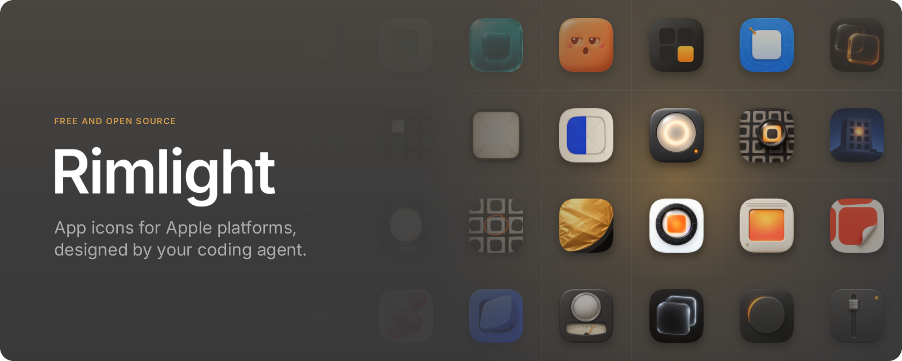
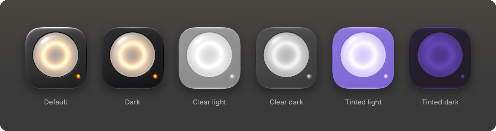
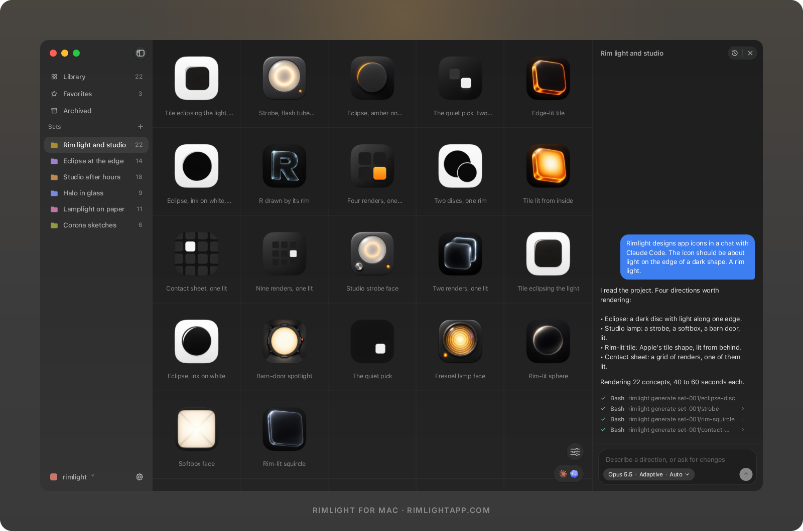

<div align="center">



<br>
<br>

[Install](#install) · [How it works](#how-it-works) · [Reference](docs/REFERENCE.md)

</div>

<br>

You ask Claude Code or Codex for an app icon. The agent pitches ideas, writes
the prompts and judges every result. Rimlight draws each one with an AI image
model, fits it to Apple's icon shape, and turns your pick into an Icon
Composer `.icon` file with Dark, Clear and Tinted versions.

You never run Rimlight by hand. You talk to your agent.

<br>

## What you need

- A Mac on macOS 26, with Xcode 26
- Claude Code or Codex
- Codex signed in to a ChatGPT plan, for the images

<br>

## Install

Paste this into your agent:

```text
Install rimlight from https://github.com/mrxnn/rimlight
```

Then start a new session, so the agent loads the skill.

<details>
<summary>Install steps for the agent</summary>

<br>

1. Build and install. `self-install` also installs the skill for Claude
   Code, and for Codex when `~/.codex` exists. The clone can be deleted
   after.

   ```sh
   git clone https://github.com/mrxnn/rimlight.git
   cd rimlight
   swift build -c release
   .build/release/rimlight self-install
   ```

2. If `codex` is missing, install it. The user signs in once, in their own
   terminal.

   ```sh
   npm i -g @openai/codex
   codex login
   ```

3. Check the install, and fix anything it reports.

   ```sh
   rimlight doctor
   ```

4. Tell the user to start a new agent session.

</details>

<br>

## How it works

Open your agent in your app's project folder and talk to it. Here's a
whole session, from first ideas to the finished icon.

<br>

### 1. Explore

> Let's explore some app icon concepts. Use Rimlight.

The agent reads your project and pitches four to six ideas. You pick the
ones you like. It then renders 16 to 24 concepts side by side, about a
minute each, and tells you which ones it would pick.

Every concept is a plain PNG in a `.rimlight/` folder inside your project.

<details>
<summary>What the agent runs</summary>

```sh
rimlight init
rimlight set rename set-001 --title "Held objects"
rimlight generate --set set-001 --slug lantern-page --title "Lantern page" --prompt-file - <<'PROMPT'
A journal page glowing like a lantern, ...
PROMPT
```

</details>

<br>

### 2. Keep going, or start fresh

> More like lantern-page, with a cooler light.

> Let's try something different. A flat mark, black on white.

More of the same goes into the same set. A new idea gets a new set, and the
agent leaves the old ones alone.

<details>
<summary>What the agent runs</summary>

```sh
rimlight set create --title "Flat marks"
rimlight generate --set set-002 --slug d-grain --title "D grain" --prompt-file - <<'PROMPT'
...
PROMPT
```

</details>

<br>

### 3. Refine

> lantern-page is the one. Try a few warmer whites.

The agent locks that icon and changes one thing per round, 8 to 12 edits
at a time. Each round starts from the last, so the icon gets closer instead
of drifting.

<details>
<summary>What the agent runs</summary>

```sh
rimlight generate --set set-001 --slug lantern-page-cream --title "Lantern page, cream" \
  --ref .rimlight/sets/set-001/lantern-page/icon.png \
  --parent set-001/lantern-page --prompt-file - <<'PROMPT'
Edit Image 1. Change the glow to a soft cream white. Keep everything else ...
PROMPT
```

</details>

<br>

### 4. Build

> Build lantern-page-cream.

The agent splits the icon into layers and has the image model redraw each
one. Rimlight packs them into a `.icon` file and renders all six
appearances. The agent checks them against your pick and fixes what came
out wrong. Most icons take four to seven images.



Drag the finished file into Xcode:

```
.rimlight/sets/set-001/lantern-page-cream/builds/main/out/Lantern page, cream.icon
```

<details>
<summary>What the agent runs</summary>

```sh
rimlight build set-001/lantern-page-cream --stage preview
rimlight build set-001/lantern-page-cream --plan-file - --dry-run <<'JSON'
{ "ground": ..., "layers": [...], "checks": [...] }
JSON
rimlight build set-001/lantern-page-cream --plan-file - <<'JSON'
...
JSON
```

</details>

<br>

## Good to know

> [!TIP]
> To pick a style, name it in your message: "Use the mascot style." The
> agent knows eight. They're listed in the
> [reference](docs/REFERENCE.md#the-styles).

> [!NOTE]
> A ChatGPT plan has a daily image limit. When Codex hits it, Rimlight stops
> and says when it resets. Nothing is lost. You can also
> [use your own OpenAI or OpenRouter key](docs/REFERENCE.md#image-models).

> [!NOTE]
> If something acts oddly, run `rimlight doctor`. It finds what's wrong and
> prints the fix.

<br>

## Commands you might type

| Command | What it does |
|---|---|
| `rimlight status` | Lists the sets and icons in this project |
| `rimlight doctor` | Checks the install and prints fixes |
| `rimlight help` | Lists every command |
| `rimlight self-uninstall` | Removes Rimlight |

<br>

## More

- [docs/REFERENCE.md](docs/REFERENCE.md), how everything works inside
- [docs/FORMAT.md](docs/FORMAT.md), every file in `.rimlight/`
- [CONTRIBUTING.md](CONTRIBUTING.md), for working on Rimlight itself

There's also [Rimlight for Mac](https://rimlightapp.com), a paid app that
shows your sets in a grid, with a chat beside them. You don't need it, but
it's nice to have.

<a href="https://rimlightapp.com"></a>

<br>

## License

Apache-2.0. See [LICENSE](LICENSE). "Rimlight" is the name of this project
and of the app, so please give a fork another name.
